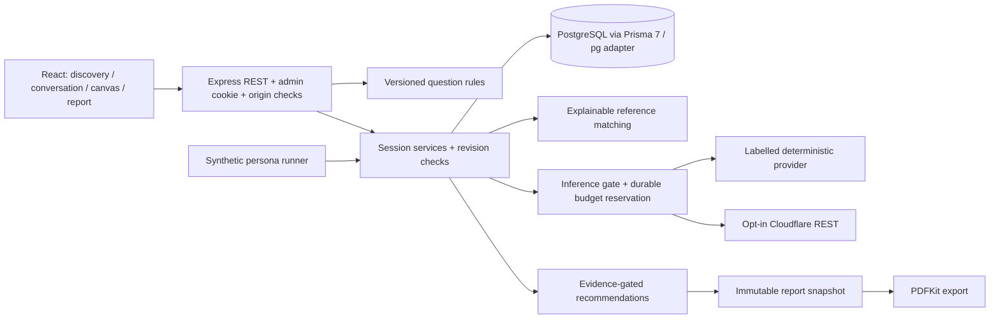

# Architecture

A modular monolith with npm workspaces keeps one consultant's operating burden small. The React/Vite frontend uses Fetch and React Router. Express exposes REST on port 5050. Shared TypeScript/Zod contracts live in `shared/src`. PostgreSQL is the only authoritative application store; there is no hidden in-memory production database.

`session-service.ts` owns mutations and orchestration. `discovery.ts`, `assessment.ts`, and `library.ts` contain testable deterministic domain logic. Provider adapters never write the database. Mutations lock the session row and compare the client revision. A conflict returns 409 and the frontend refreshes. Old branch answers are removed from the current answer set; evidence remains as inactive history. A new conversation turn also advances the revision, conservatively making an earlier report stale.

Assessment and report creation are transactional and idempotent per session revision. PDF and screen render the same stored section text. Canvas is a live projection of current confirmed answers and may be newer than an existing report snapshot.

Prisma 7.10.0 uses `prisma-client` output, JavaScript import extensions, `prisma.config.ts`, and `@prisma/adapter-pg`. JSON is reserved for bounded structured values, editable reference definitions and immutable report content, not a single session blob.

Authentication uses scrypt password hashes and revocable random session tokens, hashed at rest. Cookies are HttpOnly, SameSite=Strict and Secure in production. Mutations require an exact configured Origin. Session reads are scoped to the admin. Case knowledge is a shared private consultant library, not a multi-tenant feature.

The app is local-first in deployment, not offline-first. Reverse proxy, TLS, backups, deployment health checks, security monitoring and distributed request throttling must be designed before public hosting. Never expose the Vite development server or PostgreSQL publicly.

Version sources: [Prisma 7 upgrade guide](https://www.prisma.io/docs/guides/upgrade-prisma-orm/v7), [Cloudflare REST guide](https://developers.cloudflare.com/workers-ai/get-started/rest-api/). The initial Prisma diff command produced no SQL despite exit 0 in this environment; the checked-in relational SQL was constructed and verified by applying it to PostgreSQL and exercising the actual Prisma client.
