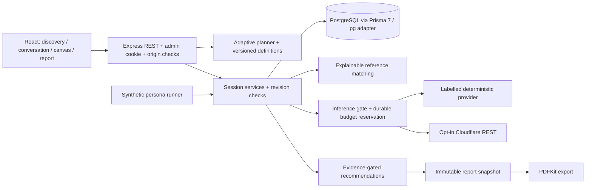

# Architecture

A modular monolith with npm workspaces keeps one consultant's operating burden small. The React/Vite frontend uses Fetch and React Router. Express exposes REST on port 5050. Shared TypeScript/Zod contracts live in `shared/src`. PostgreSQL is the only authoritative application store; there is no hidden in-memory production database.

`session-service.ts` owns mutations and orchestration. `discovery.ts`, `context-extraction.ts`, `discovery-planner.ts`, `discovery-readiness.ts`, `assessment.ts`, and `library.ts` contain testable deterministic domain logic. Provider adapters never write the database. Mutations lock the session row and compare the client revision. A conflict returns 409 and the frontend refreshes. Old branch answers are removed from the current answer set; evidence remains as inactive history. A new conversation turn also advances the revision, conservatively making an earlier report stale.

Assessment and report creation are transactional and idempotent per session revision. PDF and screen render the same stored section text. Canvas is a live projection of current confirmed answers and may be newer than an existing report snapshot.

Prisma 7.10.0 uses `prisma-client` output, JavaScript import extensions, `prisma.config.ts`, and `@prisma/adapter-pg`. JSON is reserved for bounded structured values, editable reference definitions and immutable report content, not a single session blob.

Authentication uses scrypt password hashes and revocable random session tokens, hashed at rest. Cookies are HttpOnly, SameSite=Strict and Secure in production. Mutations require an exact configured Origin. Session reads are scoped to the admin. Case knowledge is a shared private consultant library, not a multi-tenant feature.

The app is local-first in deployment, not offline-first. Reverse proxy, TLS, backups, deployment health checks, security monitoring and distributed request throttling must be designed before public hosting. Never expose the Vite development server or PostgreSQL publicly.

Version sources: [Prisma 7 upgrade guide](https://www.prisma.io/docs/guides/upgrade-prisma-orm/v7), [Cloudflare REST guide](https://developers.cloudflare.com/workers-ai/get-started/rest-api/). The initial Prisma diff command produced no SQL despite exit 0 in this environment; the checked-in relational SQL was constructed and verified by applying it to PostgreSQL and exercising the actual Prisma client.

## Iteration 002: local guest preview boundary

The immersive introduction is accessible without founder authentication. Its discovery actions create a real database session through `/api/guest/sessions`. Guest principals reuse the existing ownership relationship with a new `AdminUser.isGuest` flag; this is a minimal local-preview boundary, not public account registration. Their login is disabled and private authentication rejects guest principals even if a guest token is supplied under the founder cookie name.

`guest.ts` exposes only an allowlist of owned-session discovery, answer, chat, evidence, assessment, canvas, report and PDF operations. A separate hashed-token `kailor_guest` cookie is HttpOnly, SameSite=Strict, scoped to `/api/guest`, and expires in 24 hours. Founder cookies are never used as guest authority. Production mode and non-loopback configured API hosts disable all guest routes. Existing origin/body validation and request limits apply, plus a 20-per-hour preview creation limit.

Guest reference retrieval is restricted to public seeded definitions; reviewed founder cases are excluded. Guest chat always forces the labelled deterministic provider, so it cannot spend a Cloudflare budget. Guest sessions/reports are synthetic previews and cannot approve cases or execute the simulator. The private workspace remains at `/workspace`, with its existing login and sign-out.

Guest records persist after token expiry and restarts; there is no automatic retention cleanup or public guest recovery UI. Public deployment needs a separately designed identity/retention/rate-limit boundary. `202610130003_guest_preview` adds the role flag without removing previous records.

Assessment generation and report navigation are now separate frontend actions. Reports remain immutable backend revision snapshots; readiness is a current-snapshot projection, refreshed after mutations. Navigation and restarts preserve session ownership and history.

## Iteration 003: revision-bound adaptive projections

`DiscoverySession.contextState` and `planState` are derived JSONB projections; answers/evidence remain authoritative relational records. Mutations rebuild projections in their existing locked transaction. Legacy sessions initialize lazily. The plan persists complete question definitions, heuristic priorities, context/source links, qualitative readiness and reference/version provenance. Stable current-revision reads do not rerun model inference. See [ADR 005](../decisions/005-adaptive-projections.md).

Natural conversational extraction enters pending evidence, with individual or grouped explicit review through the same answer writer. Cloudflare receives capability-bounded context/plan; local preview has limited language rules and never routes remotely. Only approved knowledge refines priorities and next steps; industry/tools alone cannot qualify a reference. Synthetic custom personas and owner-scoped qualitative evaluation use existing simulation/case models. Historical report snapshots and PDF/Analysis structure remain intact.

## Iteration 004: independent evidence policy

Shared contracts represent quality, response states, conflicts and completion. `input-quality.ts` performs conservative deterministic screening. `knowledge-conflicts.ts` resolves narrow current facets. `evidence-policy.ts` independently establishes supported directions. `discovery-readiness.ts` exposes one readiness decision. Planner, recommendations, conversation and Canvas use that decision with the same saved answers/evidence/states. `session-state.ts` contains persistence projections; `answer-mutation.ts` owns revision-locked mutations through the session service. AI providers only propose facts, never directly write confirmed knowledge.

A normal assessment is created only after checking the current saved plan inside the revision lock, including before idempotent reuse. Reports remain immutable; changed facts/pending material corrections make them stale. Canvas uses a current eligible snapshot or validated preview, and suppresses components while blocked. Private ownership, guest isolation, provider budgets and explicit navigation remain. See ADR 006 for the sufficiency and correction boundary.

## Iteration 005

Contextual dimensions and decision gaps are projections of the existing answers/evidence, not a second knowledge store. `contextual-intelligence.ts` supplies generic operational gaps; `solution-evaluation.ts` separates evidence-based service eligibility from approved-reference approach comparison. `revision` still protects every mutation; `knowledgeRevision` controls report reuse/freshness. Optional remote planning rewords only the current validated contextual gap and persists provenance. See [ADR 007](../decisions/007-contextual-knowledge-and-case-reasoning.md) and the [iteration record](../iterations/005-contextual-intelligence.md).

## Iteration 006 conversation memory

The existing AI adapter now receives bounded role-preserving transcript memory and an on-demand deterministic older-message digest. Session data is a separate untrusted message rather than system-policy interpolation. There is no summary table or migration. Both discovery inputs still share the same transactional evidence writer, readiness and immutable reports. See [ADR 008](../decisions/008-bounded-conversation-memory.md) and the [execution record](../iterations/006-conversational-intelligence.md).

## Iteration 007 plans and personal memory

Account → owned Plan → independent DiscoverySession → answers/evidence/messages/reports. Subject remains a session label. A composite session-plan-owner FK prevents cross-account reassignment. Plan and selection revisions control lifecycle/navigation; knowledge revision controls assessment freshness. New discovery starts a fresh epoch in the existing plan; old sessions remain explicitly selectable. Existing session/report URLs survive the deterministic one-plan-per-old-session migration.

Versioned session summaries and query-scoped older retrieval complement confirmed facts and recent history. Account preferences are explicit defaults; curated Case Intelligence is separate. Plan action proposals and comparison endpoints enforce ownership and explicit decisions. See ADRs [009](../decisions/009-plan-ownership-and-lifecycle.md), [010](../decisions/010-personal-memory-authority.md), [011](../decisions/011-versioned-memory-lifecycle.md), [012](../decisions/012-explicit-cross-plan-operations.md) and [013](../decisions/013-plan-aware-model-routing.md).

## Iteration 008 accounts and conversational epochs

Private API access uses requireAccount; founder routes additionally requireAdmin. New AdminUser rows default to member despite the legacy model name. AccountInvite stores only a token hash, bound email, expiry and consumption timestamp. Registration consumes an invitation and creates a member in one transaction. Clear conversation retains messages while marking them hidden/excluded and superseding summaries; confirmed facts and report snapshots retain their knowledge revision. See [ADR 014](../decisions/014-accounts-and-opaque-conversation.md).
