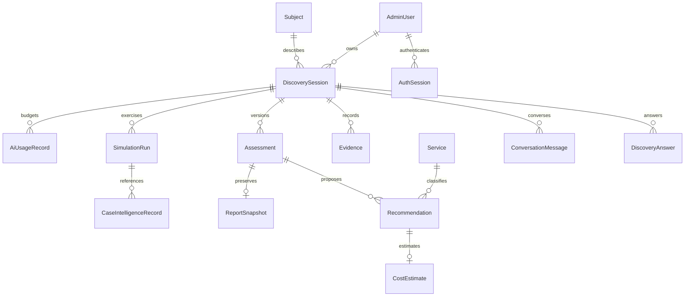

# Data model

| Model                  | Responsibility                                                                                  |
| ---------------------- | ----------------------------------------------------------------------------------------------- |
| AdminUser              | Email, scrypt hash, ownership of discoveries                                                    |
| AuthSession            | Hashed token and eight-hour absolute expiry                                                     |
| Subject                | Private display name and synthetic flag                                                         |
| DiscoverySession       | Owner, subject, definition version, revision, synthetic flag, nullable context/plan projections |
| DiscoveryAnswer        | Unique current answer per question and session; skipped state                                   |
| ConversationMessage    | Persistent role, content, provider and stable ordinal                                           |
| Evidence               | Fact/proposal value, source, confirmation state and active/history flag                         |
| Assessment             | Draft, session revision, summary; unique per session revision                                   |
| Recommendation         | Service, evidence, problem, benefits, alternatives, delivery and next steps                     |
| Service                | Editable seeded service catalogue and optional consultant hour inputs                           |
| CostEstimate           | Implementation range, currency, status and separate vendor cost status                          |
| ReportSnapshot         | Immutable seven-section content linked to assessment                                            |
| ScenarioTemplate       | Editable seed definition and industry                                                           |
| SimulationRun          | Persona definition/answers/chat inputs, path, session and assessment IDs, notes and approval    |
| CaseIntelligenceRecord | Independent source and review classification, sanitized reusable pattern                        |
| AiUsageRecord          | Durable call/output allowance reservation, mode, provider, result status and fallback reason    |
| AuditEvent             | Actor, action, entity ID and non-sensitive mutation metadata                                    |

Migrations: `202610130001_initial` creates the relational schema and constraints; `202610130002_message_order` adds stable per-session chat ordinals, including a deterministic backfill. IDs are generated by Prisma; timestamps use UTC. All application relationships use foreign keys except generic audit entity references and the stored simulation assessment identifier (validated by the simulation service). Both migrations have been applied to development and isolated test databases.

Current answers are mutable, but previous confirmed evidence is deactivated rather than erased. Reports never change after creation. Answer history can be reconstructed from evidence and audit metadata; skipped answers do not create factual evidence. A full event-sourced replay system is not implemented.

Iteration 002 adds `AdminUser.isGuest` (default false) through `202610130003_guest_preview`. This preserves existing founder records and gives local preview principals a distinct server-enforced role. Guest records use the existing foreign-key ownership relationships; they do not receive founder privileges. Guest report/session flags are synthetic, and restart creates a new discovery rather than deleting history.

Iteration 003 migration `202610140001_adaptive_context` adds nullable JSONB `contextState` and `planState`. No historical records are dropped or rewritten. The current plan carries its session revision, planner/definition version, complete adapted questions, source-linked context, qualitative readiness and approved reference IDs. These fields are rebuildable projections, not a second authoritative knowledge store. Applied to local development and isolated test PostgreSQL; regenerate Prisma before starting updated code.

New `SimulationRun.discoveryPath` entries contain questionId/title/value/skipped/revision/source, preserving actual deterministic question wording. Historical arrays of question IDs remain valid historical JSON. Reviewed evaluationNotes stores `{automated,review}` as JSON text; unreviewed historical text remains supported. The existing evidence active/status/source and answer unique constraints remain unchanged. No embedding tables, fine-tuning store or website-inspection records were introduced.

## Iteration 004 additive migration

`202610140002_intelligence_reliability` adds DiscoveryAnswer.responseState (default answered) and nullable quality JSONB; backfills existing skipped and exact Not applicable answers. Evidence.provenance is nullable JSONB for quote/message ID, extraction basis, quality, conflicts, confirmed resolution and retirement reasons. SimulationRun.assessmentId becomes nullable so failed discovery can persist without a fabricated report. CaseIntelligenceRecord.reviewVersion starts at zero and increments on review. Existing report JSON and evidence history remain untouched.

Context/plan projections persist readiness, completion/reasons, conflicts and answer/question states at the session revision. Historical null metadata is interpreted lazily; plan caches require the new planner version and completion/question-state contracts. No destructive reset, secret/password update or historical snapshot rewrite occurred. Migration and Prisma generation were applied to kailor and kailor_test.

## Iteration 005 additive data changes

Migration `202610140003_contextual_knowledge` adds `DiscoverySession.knowledgeRevision`, `Assessment.knowledgeRevision` and the assessment session/knowledge-revision index. Legacy counters are conservatively backfilled from their activity revisions; report JSON is untouched. Optimistic locking still uses `revision`. Context/plan JSON additionally carries statement status, decision gaps, planned-question snapshots and optional model-generation provenance. Case alternatives/dimensions remain validated pattern JSON; locked review audit history preserves prior approved versions and source classification.

## Iteration 007 additive relations

Plan has an immutable UUID, owner FK, title/description, archive timestamp, revision, request key and last selected session. `DiscoverySession(planId, adminId)` references `Plan(id, adminId)`; existing Subject/session/report identities remain. Migration `202610150001_plans_and_memory` creates one plan per historical session, even when labels/subjects are shared. It changes no evidence, report content or authentication credentials.

AccountSettings stores activePlanId and selection revision. AccountPreference stores a small explicit key/value default with revision; cleared values are empty tombstones omitted from model context. ConversationSummary stores version, knowledge/source revisions, ordinal coverage, strategy, superseded flag and source-backed excerpt JSON. PlanActionProposal records the source message/revision, suggested title/description and explicit review result. ConversationMessage adds intent and an exclusion flag for application-action turns. Plan ownership, lifecycle/list paths, sessions, summaries and pending proposals have indexes. The active-session/selection pointer membership is validated by services; the session-plan owner boundary is also enforced by its composite FK.

## Iteration 008 additive fields

AdminUser.role defaults to member. A case-insensitive unique email index prevents case-variant duplicate accounts. AccountInvite holds tokenHash, email, expiresAt, usedAt, createdBy and createdAt; codes are never stored raw. ConversationMessage.hiddenFromTranscript defaults false and is independent from excludedFromContext, since application-action turns can remain visible while excluded from model history. Clearing increments activity revision, retires pending evidence/proposals and invalidates summaries, preserving knowledge revision and immutable reports. The configured-founder preservation helper never creates an account.

## Solution canvas and request snapshots (iteration 018)

Solutions are a current read projection of existing recommendation/direction identities, not a parallel authoritative recommendation table. Requirement priorities and evidence references remain in the existing consulting model. `Plan.canvasState.edits` additionally supports explicitly user-authored scoped capabilities; optional `selections` records selected state, reviewed scope fingerprint and timestamp. Legacy decisions/additions are adapted without rewriting JSON or historical reports.

`ConsultancyRequest` belongs to `Plan`, retains owner/session provenance, a unique retry UUID, server-owned pending status/timestamp, notes and immutable JSON scope. Scope captures selected solution IDs/fingerprints, individual objectives/capabilities/evidence, recorded constraints and project/knowledge revisions. Project ownership, current selection, reconciled scope and optimistic revision are checked at intake. The project foreign key cascades with project deletion. No consultant or implementation is inferred from this record.

The additive `202610170001_solution_requests` migration creates that table/indexes and inserts the explicit Instagram-setup service if missing. Existing sessions, Canvas state and assessment snapshots are preserved. Future commissioned engagements must join project/solution identities to separately accepted immutable scope and authoritative progress records. See [iteration 018](../iterations/018-solution-canvas-rebuild.md).
