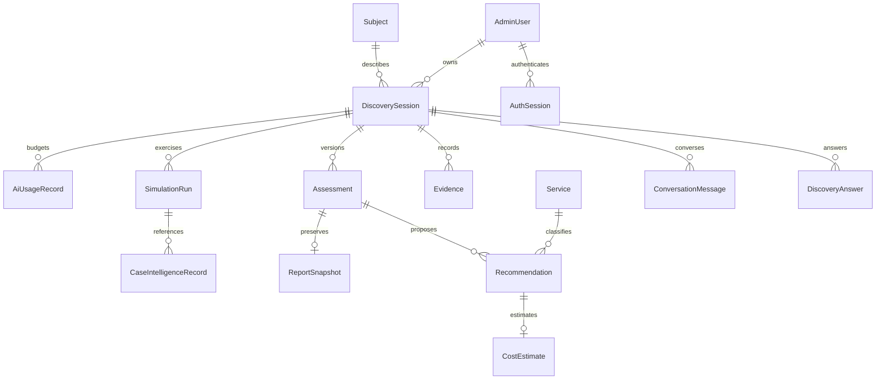

# Data model

| Model                  | Responsibility                                                                                  |
| ---------------------- | ----------------------------------------------------------------------------------------------- |
| AdminUser              | Email, scrypt hash, ownership of discoveries                                                    |
| AuthSession            | Hashed token and eight-hour absolute expiry                                                     |
| Subject                | Private display name and synthetic flag                                                         |
| DiscoverySession       | Owner, subject, definition version, revision, synthetic flag, nullable context/plan projections |
| DiscoveryAnswer        | Unique current answer per question and session; skipped state                                   |
| ConversationMessage    | Persistent role, content, provider and stable ordinal                                           |
| Evidence               | Fact/proposal value, source, confirmation state and active/history flag                         |
| Assessment             | Draft, session revision, summary; unique per session revision                                   |
| Recommendation         | Service, evidence, problem, benefits, alternatives, delivery and next steps                     |
| Service                | Editable seeded service catalogue and optional consultant hour inputs                           |
| CostEstimate           | Implementation range, currency, status and separate vendor cost status                          |
| ReportSnapshot         | Immutable seven-section content linked to assessment                                            |
| ScenarioTemplate       | Editable seed definition and industry                                                           |
| SimulationRun          | Persona definition/answers/chat inputs, path, session and assessment IDs, notes and approval    |
| CaseIntelligenceRecord | Independent source and review classification, sanitized reusable pattern                        |
| AiUsageRecord          | Durable call/output allowance reservation, mode, provider, result status and fallback reason    |
| AuditEvent             | Actor, action, entity ID and non-sensitive mutation metadata                                    |

Migrations: `202610130001_initial` creates the relational schema and constraints; `202610130002_message_order` adds stable per-session chat ordinals, including a deterministic backfill. IDs are generated by Prisma; timestamps use UTC. All application relationships use foreign keys except generic audit entity references and the stored simulation assessment identifier (validated by the simulation service). Both migrations have been applied to development and isolated test databases.

Current answers are mutable, but previous confirmed evidence is deactivated rather than erased. Reports never change after creation. Answer history can be reconstructed from evidence and audit metadata; skipped answers do not create factual evidence. A full event-sourced replay system is not implemented.

Iteration 002 adds `AdminUser.isGuest` (default false) through `202610130003_guest_preview`. This preserves existing founder records and gives local preview principals a distinct server-enforced role. Guest records use the existing foreign-key ownership relationships; they do not receive founder privileges. Guest report/session flags are synthetic, and restart creates a new discovery rather than deleting history.

Iteration 003 migration `202610140001_adaptive_context` adds nullable JSONB `contextState` and `planState`. No historical records are dropped or rewritten. The current plan carries its session revision, planner/definition version, complete adapted questions, source-linked context, qualitative readiness and approved reference IDs. These fields are rebuildable projections, not a second authoritative knowledge store. Applied to local development and isolated test PostgreSQL; regenerate Prisma before starting updated code.

New `SimulationRun.discoveryPath` entries contain questionId/title/value/skipped/revision/source, preserving actual deterministic question wording. Historical arrays of question IDs remain valid historical JSON. Reviewed evaluationNotes stores `{automated,review}` as JSON text; unreviewed historical text remains supported. The existing evidence active/status/source and answer unique constraints remain unchanged. No embedding tables, fine-tuning store or website-inspection records were introduced.
